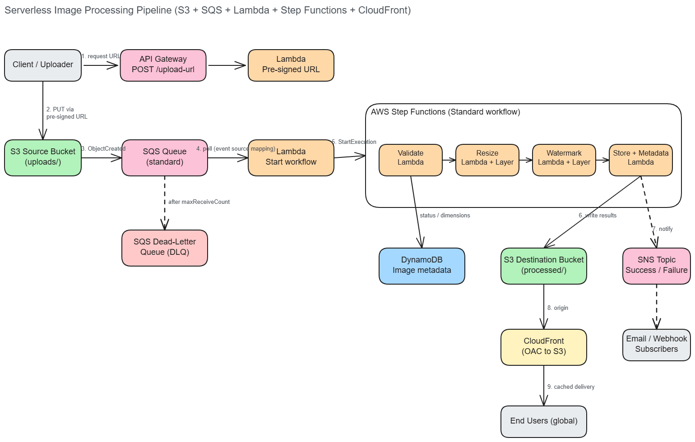
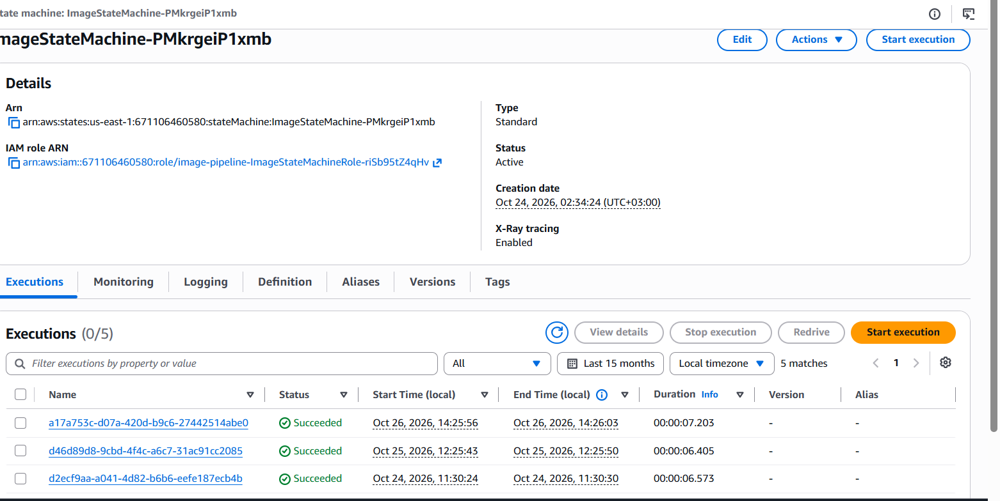
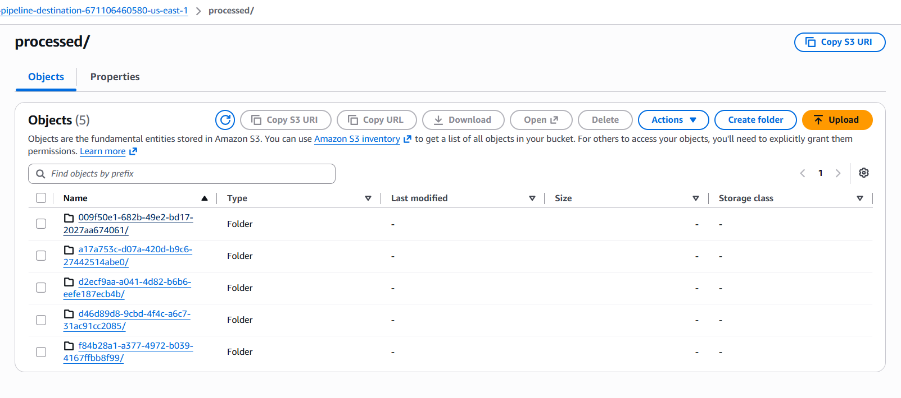
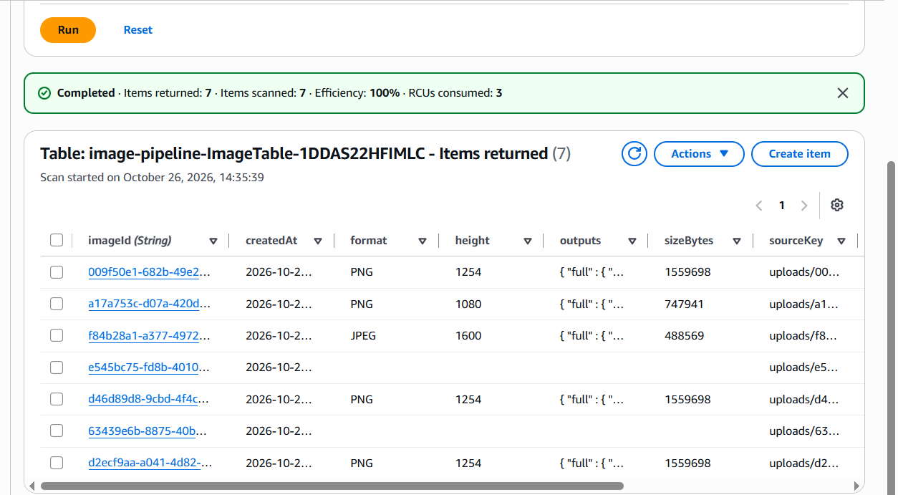

# Serverless Image Processing Pipeline

An event-driven, serverless pipeline on AWS. Images uploaded to S3 are queued in SQS, processed by a Step Functions workflow (validate, resize, watermark, store), and delivered through CloudFront. Built with AWS SAM and deployed to `us-east-1`.

## Live demo

**Try it:** https://pta9xsrf4l.execute-api.us-east-1.amazonaws.com/

Open the link, choose a JPEG, PNG or WebP image (up to 5 MB), and the page uploads it, follows the workflow, and shows the thumbnail and the resized, watermarked result.

> This is a public demo with no authentication, so please don't upload private images. The stack may be taken down after evaluation.

## Architecture



**Flow**

0. The demo page is served by a Lambda behind `GET /` and polls `GET /images/{id}` for the result.
1. The client calls `POST /upload-url` on API Gateway. A Lambda returns a pre-signed S3 `PUT` URL and creates a `PENDING` record in DynamoDB.
2. The client uploads the image directly to the **source bucket** (`uploads/`).
3. S3 sends an `ObjectCreated` event to an **SQS queue**. Messages that fail 3 times move to a **dead-letter queue**.
4. A Lambda consumes the queue and starts one **Step Functions** execution per image.
5. The workflow runs **Validate → Resize → Watermark → Store**. Any failure marks the record `FAILED` and publishes to SNS.
6. Processed images (`thumbnail` and `full`, WebP) are written to the **destination bucket** (`processed/`).
7. On success, **SNS** publishes a notification and DynamoDB is set to `COMPLETED`.
8. **CloudFront** serves `processed/*` from the destination bucket using Origin Access Control. The bucket is not public.

## AWS services

| Service | Role |
|---|---|
| S3 (source, destination) | Storage, event notifications, lifecycle rules, bucket policies |
| SQS + DLQ | Decouples uploads from processing; retries and failure isolation |
| Lambda + Layer | Presign, workflow start, validate, resize, watermark, store; Pillow shipped as a Layer |
| Step Functions (Standard) | Orchestration, retries, error handling |
| API Gateway (HTTP API) | Demo page (`GET /`), pre-signed URL endpoint (`POST /upload-url`), status endpoint (`GET /images/{id}`) |
| DynamoDB | Image metadata and status |
| CloudFront | Global delivery with long-lived caching |
| SNS | Success and failure notifications |

## Deployment details

| Item | Value |
|---|---|
| Region | `us-east-1` |
| Stack name | `image-pipeline` |
| Source bucket | `image-pipeline-source-<ACCOUNT_ID>-us-east-1` |
| Destination bucket | `image-pipeline-destination-<ACCOUNT_ID>-us-east-1` |
| Demo URL | `https://pta9xsrf4l.execute-api.us-east-1.amazonaws.com/` |
| Upload endpoint | `POST https://pta9xsrf4l.execute-api.us-east-1.amazonaws.com/upload-url` |
| Tooling | AWS SAM CLI 1.169.0, Docker Desktop, AWS CLI 2.x on Windows |

> **CloudFront status:** new AWS accounts must be verified by AWS Support before they can create CloudFront distributions. This stack was deployed and tested with `EnableCloudFront=false`, in which case the Store step returns temporary pre-signed S3 URLs instead of CloudFront URLs. Everything else in the pipeline is identical. The CloudFront configuration is included in the template and is enabled by redeploying with `EnableCloudFront=true` once the account is verified.

## Design decisions

- **Why SQS between S3 and processing:** uploads never wait on processing. Spikes are absorbed by the queue, failed messages are retried, and poison messages end up in the DLQ instead of being lost.
- **Idempotency:** the execution name is the image ID, so duplicate SQS deliveries cannot start duplicate workflows. The consumer reports partial batch failures so only the failed messages are retried.
- **Lifecycle rules:** originals move to Standard-IA (30 days), then Glacier Instant Retrieval (90 days), and expire after 365 days. Intermediate `work/` files expire after 1 day. Processed images move to Intelligent-Tiering after 30 days.
- **Caching:** processed keys include a unique image ID, so objects are immutable and served with `max-age=31536000, immutable`.
- **Security:** both buckets block public access and use SSE. CloudFront can read only `processed/*`. Each Lambda has least-privilege IAM through SAM policy templates.

## Deploy

Prerequisites: AWS CLI configured (`aws configure`), [AWS SAM CLI](https://docs.aws.amazon.com/serverless-application-model/latest/developerguide/install-sam-cli.html), and Docker Desktop (running) for building the Pillow layer.

Build from a path without spaces or non-ASCII characters, because SAM CLI on Windows fails to write its build files otherwise.

```powershell
sam build --use-container
sam deploy --guided --stack-name image-pipeline
```

Use a **lowercase** stack name, because it is part of the S3 bucket names. If your account is not yet verified for CloudFront:

```powershell
sam deploy --parameter-overrides EnableCloudFront=false
```

After deployment, open the `DemoUrl` stack output in a browser.

Optional parameters: `WatermarkText`, `NotificationEmail`, `MaxImageBytes` (default 5 MB), `EnableCloudFront`.

## Test it

Get the stack outputs:

```powershell
aws cloudformation describe-stacks --stack-name image-pipeline --query "Stacks[0].Outputs" --output table
```

**PowerShell (no Python needed):**

```powershell
$api  = "<UploadUrlEndpoint>"
$file = "C:\path\to\photo.jpg"
$type = "image/jpeg"

$body = @{ filename = (Split-Path $file -Leaf); contentType = $type } | ConvertTo-Json
$r = Invoke-RestMethod -Method Post -Uri $api -Body $body -ContentType "application/json"
Invoke-RestMethod -Method Put -Uri $r.uploadUrl -InFile $file -ContentType $type
$r.imageId
```

The `Content-Type` of the upload must match the requested `contentType`, because it is part of the signed URL.

**Python alternative:**

```bash
python scripts/test_upload.py <UploadUrlEndpoint> <CloudFrontDomain|none> path/to/image.jpg
```

Then list the results:

```powershell
aws s3 ls s3://<DestinationBucketName>/processed/ --recursive
```

### Verified result

An uploaded JPEG produced both variants within a second of each other:

```
2026-10-24 10:11:02      36190 processed/009f50e1-682b-49e2-bd17-2027aa674061/full.webp
2026-10-24 10:11:01       5382 processed/009f50e1-682b-49e2-bd17-2027aa674061/thumbnail.webp
```





> Add your screenshots to `serverless-image-pipeline/docs/screenshots/` using these file names.

## Failure handling

| Failure | Behaviour |
|---|---|
| Not an image, too large, unsupported format | `Validate` raises, record marked `FAILED`, SNS notified |
| Transient Lambda errors | Retried with exponential backoff inside the workflow |
| Consumer cannot start the workflow | SQS retries 3 times, then the message goes to the DLQ |

## Cost and cleanup

Everything is pay-per-use and idle cost is near zero. To remove everything, empty the buckets first:

```powershell
aws s3 rm s3://image-pipeline-source-<ACCOUNT_ID>-us-east-1 --recursive
aws s3 rm s3://image-pipeline-destination-<ACCOUNT_ID>-us-east-1 --recursive
sam delete --stack-name image-pipeline
```

## Possible improvements

- Add authentication to the upload endpoint (Cognito JWT authorizer or IAM). It is open in this demo, so the stack should not stay deployed long-term.
- Add a `GET /images/{id}` endpoint to read status from DynamoDB.
- Add AWS WAF in front of CloudFront and restrict the S3 CORS origin.
- Use a Map state to produce more variants in parallel.

## Project structure

```
├── template.yaml              # SAM template (all infrastructure)
├── statemachine/definition.asl.json
├── src/                       # one folder per Lambda (incl. ui/ demo page and status/)
├── layers/image-libs/         # Pillow layer
├── scripts/test_upload.py
└── docs/
    ├── architecture.excalidraw
    ├── architecture.png
    └── screenshots/
```
